# 🎮 AUDIRA-AGENT: 3D AI Game Dev Studio & Cyber Asset Command Center

[](LICENSE)
[](https://threejs.org/)
[](https://vitejs.dev/)
[](https://nodejs.org/)
[](https://github.com/Audira141415/AUDIRA-AGENT)

**AUDIRA-AGENT** adalah Pusat Komando Virtual 3D Interaktif berbasis **Three.js WebGL** untuk Studio Game dan Pipeline Asset 3D `.GLB`. Mengintegrasikan armada AI Game Developer otonom (*Arthur, ROUTEX, CHRONOS, RESOLV, CIPHER, VOLTIS, dll*), **Catwalk Runway 56m 8-Slot**, **Master Production Wall 9-Layar**, dan **Live Hardware Telemetry Bridge** (RTX 3060 CUDA, Ollama, dan host system).

---

## 📸 Studio Gallery & Visual Showcase

### 1. 3D Cyber Game Studio Main Hall (68m x 52m)
Virtual 3D Studio dengan 6 Sektor Cyber Studio, 8 Pod Runway, Master Production Wall, dan pencahayaan dinamis.
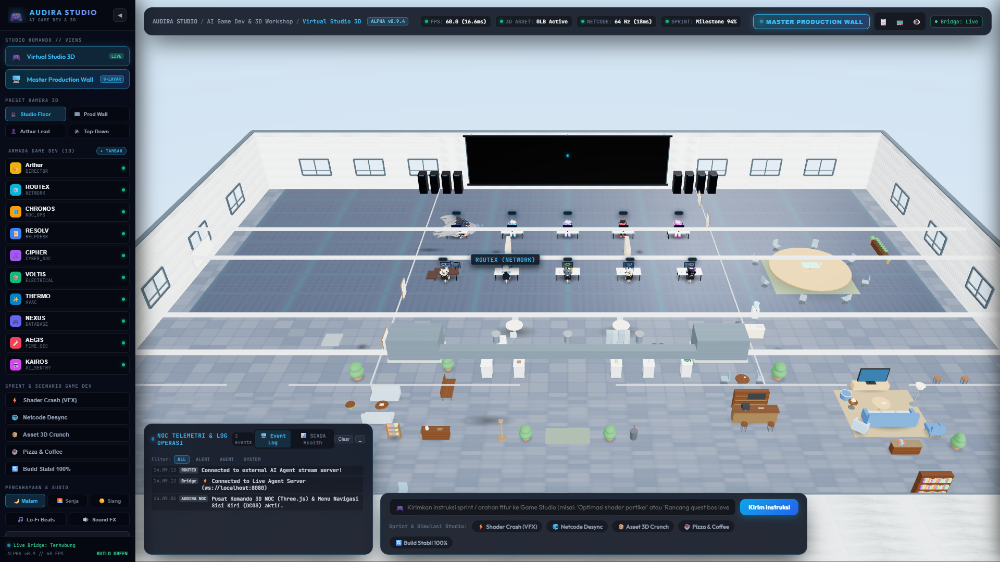

### 2. 9-Screen Master Production Wall
Layar interaktif 10.8m x 4.4m bertekstur dinamis real-time (FPS telemetry, 3D pipeline polygon stats, multiplayer netcode tickrate 64Hz, level navmesh, milestone countdown, audio visualizer, sprint directives).
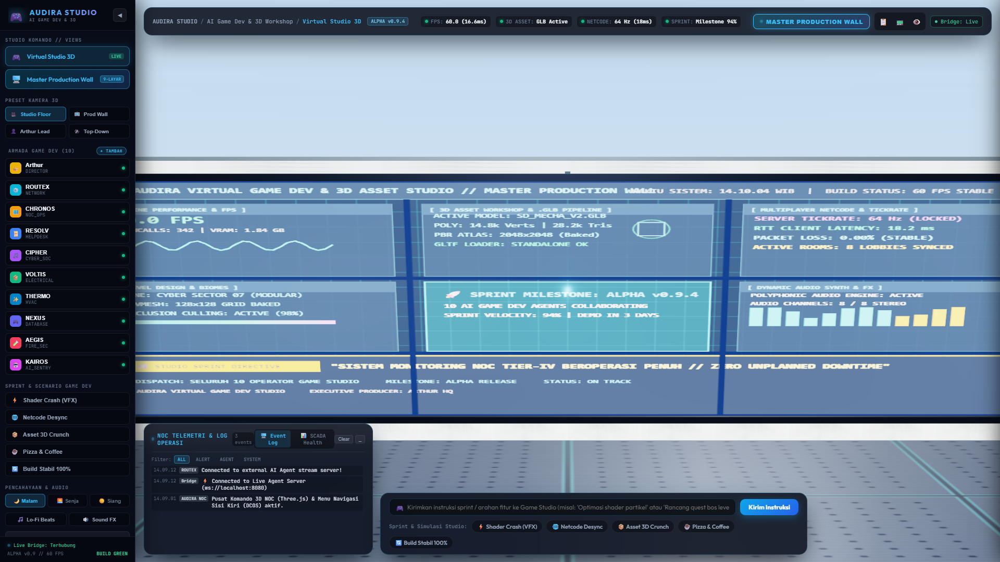

### 3. Phase 3: Interactive Runway Controls Deck
Deck kontrol glassmorphism atas: kendali kecepatan conveyor (`0.5x`, `1.0x`, `2.0x`), jeda/lanjutkan, gerak dua arah (`⇥/⇤`), 360° turntable spin toggle, serta preset tema kurasi (*Cyber Mecha Expo*, *Warlords & Beasts*).
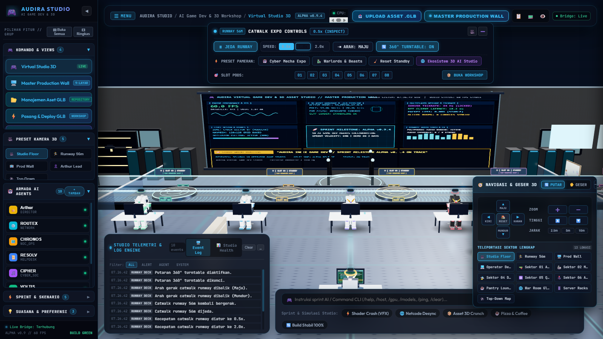

### 4. Phase 3: Spatial Raycasting & Cinematic Fly-To
Interaksi klik langsung ke pod catwalk runway atau sektor studio dengan transisi kamera sinematik cubic ease-out.
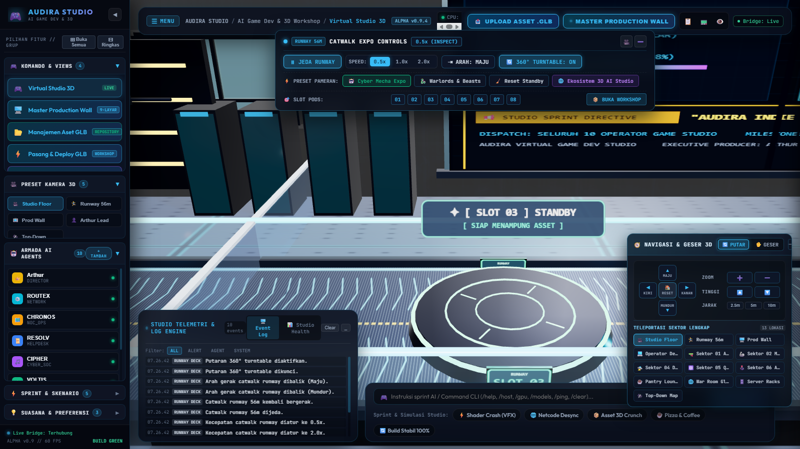

### 5. Phase 3: RTX 3060 AI Studio Ecosystem Bridge
Modal Asset Library yang terhubung langsung secara real-time ke workstation RTX 3060 (`F:\AUDIRA-3D-AI-Studio`), menampilkan model hasil generate AI dan impor instan 1-klik ke runway.
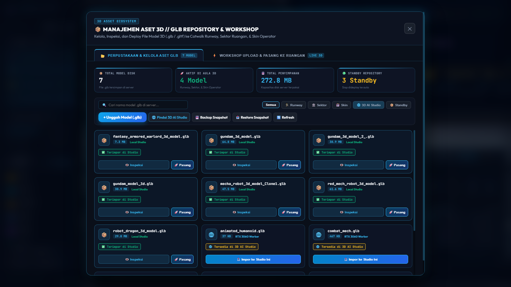

### 6. Phase 2: Multi-Tier Real AI Fleet Reasoning
Modal konfigurasi Multi-Tier AI: Google Gemini 2.0 Flash (Cloud), Local Ollama LLM (`gemma2:latest`), dan Domain Knowledge Fallback.
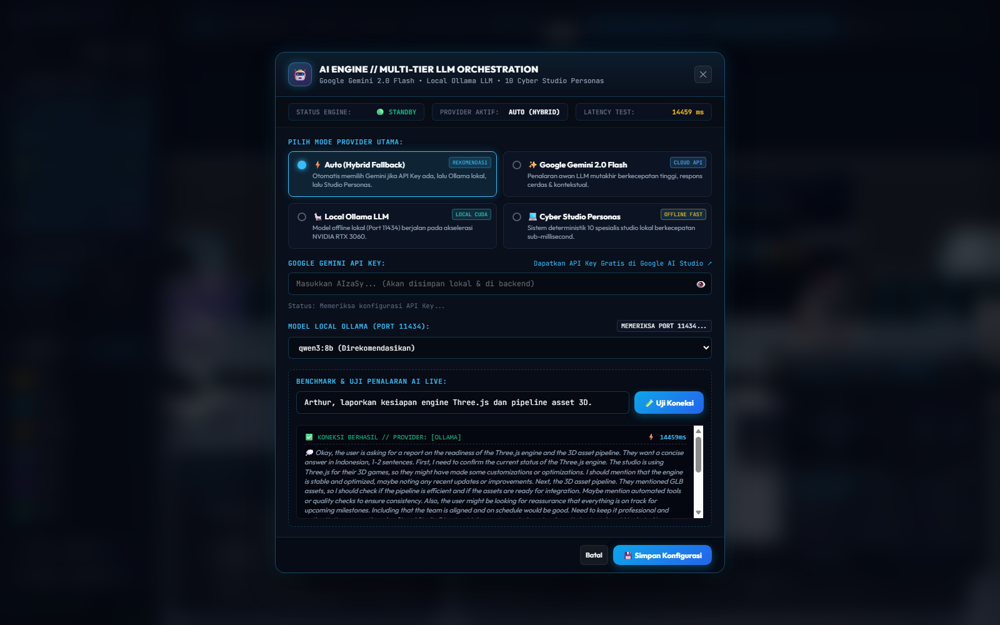

### 7. Phase 2: Live AI Fleet Commlink & Spatial Reasoning
HUD Commlink transparan dengan status reasoning langsung para agen, latency LLM, token metrics, dan dialog inter-operator.
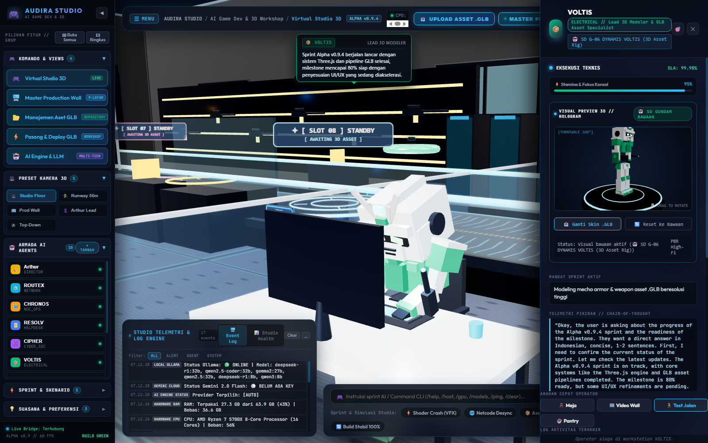

### 8. Phase 2: TaskBar Slash Command Dispatcher & Autonomous Orchestration
Dispatcher arahan resmi dengan perintah slash (`/sprint`, `/fix`, `/review`, `/deploy`, `/ai-status`) dan penalaran otonom bertingkat.
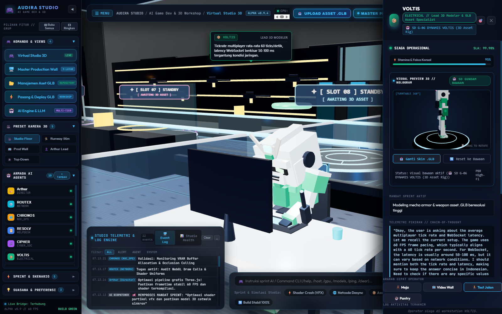

### 9. Phase 1: Real-Time PBR Realistic Shading Engine
Inspeksi material fisik realistis (PBR) dengan normal mapping, roughness, metallic, dan telemetri poligon (verts, tris, draw calls).
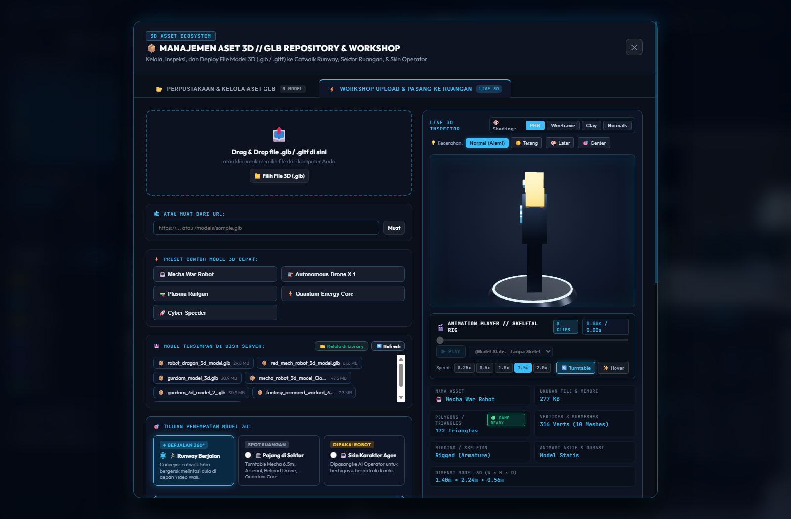

### 10. Phase 1: Wireframe Topology Inspection
Mode inspeksi wireframe real-time untuk audit topologi mesh 3D dan analisis edge flow model game.
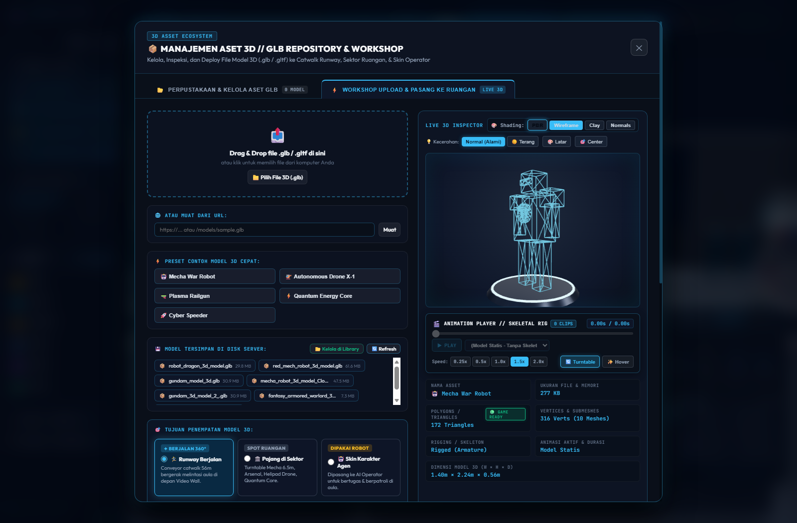

### 11. Phase 1: Warlord 3D Model on Catwalk Turntable
Inspeksi model 3D GLB karakter Warlord di atas pedestal catwalk turntable dengan rotasi 360°.
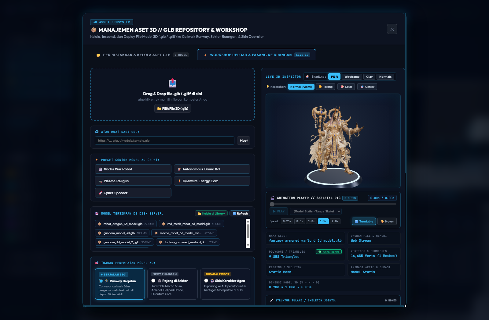

---

## 🌟 Fitur Utama

- **🏗️ 100% 3D Three.js WebGL Architecture**:
  - Ruang aula 68m x 52m dengan grid lantai modular, pencahayaan studio cyber HSL, dan CSS2DRenderer spatial speech bubble.
  - Catwalk Runway 56m dengan 8 pedestal slot turntable independen.
  - Shading Switcher 4 Mode: **PBR Realistic**, **Wireframe Mesh**, **Clay Sculpt**, dan **Surface Normals**.
- **🧠 Multi-Tier Real AI Engine**:
  - **Tier 1 (Cloud)**: Google Gemini 2.0 Flash untuk arsitektur kompleks dan perencanaan sprint.
  - **Tier 2 (Edge/Local)**: Ollama LLM lokal (`gemma2:latest`, `llama3`) tanpa ketergantungan internet.
  - **Tier 3 (Domain Fallback)**: Mesin respon deterministik cerdas spesialis studio game.
- **🖥️ 9-Screen Master Production Wall**:
  - Layar 3x3 array dengan canvas beranimasi dinamis 60 FPS: Engine FPS, 3D Assets, Netcode Tickrate, Biome Navmesh, Sprint Countdown, Audio Synth, dan Broadcast Mandate.
- **🌉 RTX 3060 AI Studio Ecosystem Live Bridge**:
  - Endpoint REST API (`/api/ecosystem-assets`, `/api/ecosystem-import`) yang menyinkronkan aset dari render farm RTX 3060 ke runway catwalk secara instan.
- **👥 Armada AI Game Developer (Autonomous Fleet)**:
  - 👑 **Arthur**: Executive Game Director & Studio Head
  - ⚙️ **ROUTEX**: Multiplayer Netcode & 64Hz Tickrate Architect
  - 🗺️ **CHRONOS**: Lead Level Designer & Biome Proceduralist
  - 📜 **RESOLV**: Narrative Lead & Questline Writer
  - 🎵 **CIPHER**: Procedural Audio & Sound FX Engineer
  - 📦 **VOLTIS**: Lead 3D Modeler & GLB Asset Specialist
  - 🧪 **AEGIS**: Lead QA & Bot Playtester
  - 🤖 **KAIROS**: Autonomous AI Game Director
- **🎵 Procedural Web Audio Engine**:
  - Lo-Fi beats sintetis, mechanical keyboard clack, dan SFX interface 100% prosedural via Web Audio API tanpa dependensi file audio eksternal.

---

## 🚀 Panduan Menjalankan

### Cara 1: Launcher Otomatis 1-Klik (Windows)
- Jalankan **[`start.bat`](start.bat)**:
  - Otomatis mengecek dan menginstal dependensi (`node_modules`).
  - Menjalankan Backend WebSocket & Telemetry Bridge (`server.js`) pada Port `8080`.
  - Menjalankan Frontend Vite Dev Server pada Port `5173`.
  - Membuka browser default secara otomatis di `http://localhost:5173/`.
- Hentikan dengan **[`stop.bat`](stop.bat)**:
  - Menghentikan proses Node.js dan Vite pada Port 5173 dan 8080 secara bersih.

### Cara 2: Simpan & Push ke GitHub 1-Klik
- Jalankan **[`save.bat`](save.bat)**:
  - Otomatis melakukan `git init` (jika belum ada).
  - Menyetel remote origin ke `https://github.com/Audira141415/AUDIRA-AGENT.git`.
  - Melakukan staging semua file proyek dan screenshot.
  - Melakukan commit dengan pesan kustom (atau pesan otomatis dengan timestamp).
  - Melakukan push ke branch `main`.

### Cara 3: Manual Terminal

```bash
# 1. Install dependensi
npm install

# 2. Jalankan Backend Server (WebSocket & Ingestion API Port 8080)
node server.js

# 3. Jalankan Frontend Vite (Port 5173) di terminal terpisah
npm run dev

# 4. Validasi Build Production
npm run build
```

---

## 📁 Struktur Direktori

```text
AUDIRA-AGENT/
├── .agents/                   # Standar Tata Kelola & Dokumen Arsitektur Proyek
│   ├── ARCHITECTURE.md        # Topologi teknis, Three.js pipeline, AI routing
│   ├── PRD.md                 # Product Requirements Document
│   ├── DESIGN.md              # Design system Dark Glassmorphism, palet HSL
│   └── TASK_INSTRUCTION.md    # Panduan task developer
├── dist/                      # Direktori kompilasi build production
├── screenshots/               # Arsip screenshot resolusi tinggi studio & fitur
│   ├── 01_studio_overview_3d.png
│   ├── 02_master_video_wall_9screen.png
│   ├── 03_phase3_runway_controls_deck.png
│   ├── 04_phase3_spatial_flyto_turntable.png
│   ├── 05_phase3_ecosystem_library_bridge.png
│   ├── 06_phase2_multi_tier_ai_config.png
│   ├── 07_phase2_commlink_active_reasoning.png
│   ├── 08_phase2_ai_mandate_orchestration.png
│   ├── 09_phase1_pbr_shading_mode.png
│   ├── 10_phase1_wireframe_inspection.png
│   └── 11_phase1_warlord_turntable.png
├── public/                    # Aset statis & 3D GLB model bawaan
├── src/
│   ├── engine/                # Core 3D Three.js & Procedural Web Audio
│   │   ├── 3d/                # Scene Three.js, Runway Conveyor, Video Wall, Build
│   │   ├── AudiraOffice3D.js  # Wrapper interaksi 3D, raycasting, camera fly-to
│   │   └── AudioManager.js    # Sintesis audio prosedural Web Audio API
│   ├── agents/                # Manajemen Armada AI & Multi-Agent Workflow
│   │   ├── AgentRegistry.js   # Registri agen & persistensi localStorage
│   │   └── MultiAgentWorkflow.js # Orkestrasi skenario game dev
│   ├── ui/                    # UI Components (Dark Glassmorphism)
│   │   ├── SidebarNav.js      # Sidebar navigasi sisi kiri & kamera presets
│   │   ├── RunwayControlDeck.js # Panel kontrol Catwalk Runway atas
│   │   ├── AssetManagerModal.js # Modal Asset Library & Ecosystem Bridge
│   │   ├── AIConfigModal.js   # Modal konfigurasi Multi-Tier AI
│   │   ├── AgentInspector.js  # Panel detail agen sisi kanan
│   │   ├── TerminalLog.js     # Console log telemetri bawah
│   │   └── TaskBar.js         # Input arahan resmi & slash commands
│   ├── network/               # Lapisan Komunikasi Real-time
│   │   └── AgentBridge.js     # WebSocket client connector
│   ├── style.css              # Master Design System (CSS Variables, Glassmorphism)
│   └── main.js                # App bootstrap & event hub
├── index.html                 # Viewport 3D & HUD root layout
├── server.js                  # WebSocket server, hardware telemetry & ecosystem bridge
├── LICENSE                    # Lisensi Open Source MIT
├── save.bat                   # 1-Click Git Stage, Commit & Push ke GitHub
├── start.bat                  # 1-Click Start Server & Vite
└── stop.bat                   # 1-Click Stop Server & Vite
```

---

## 📜 Lisensi

Proyek ini dilisensikan di bawah [MIT License](LICENSE) - Bebas digunakan, dimodifikasi, dan didistribusikan untuk keperluan personal maupun komersial.
